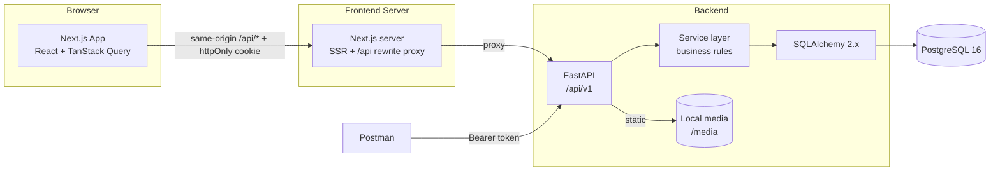

# 03 — Application Architecture

## 1. System overview



**Style:** a modular monolith REST backend with a layered design, plus a separately deployed Next.js frontend.

## 2. Key architectural decisions (ADR summary)

| # | Decision | Why | Alternatives rejected |
|---|---|---|---|
| ADR-1 | **The backend owns every business rule.** The frontend never sends prices, totals or cart contents at checkout | Rules 5 and 6. A single source of truth. Tests can target the API directly | Validation in the frontend only (insecure) |
| ADR-2 | **Server-side cart** in `cart_items` | Rules 1, 3 and 4 become enforceable and testable. The cart survives across devices | localStorage cart (would be frontend-only fake functionality) |
| ADR-3 | **Order created before payment** (`PENDING_PAYMENT`), with payments as separate attempt rows | Rules 9–12: retries reuse the same order. Order status and payment status stay cleanly separate | Creating the order only after payment succeeds (loses the attempt history and complicates retry) |
| ADR-4 | **Idempotency keys** with unique DB constraints on orders and payments | Guarantees no duplicates even under real concurrency, not just in the UI | Relying only on a disabled button |
| ADR-5 | **Explicit state machine** in one module (`order_state_machine.py`) | Rule 13 is a single, unit-testable table. Routes cannot bypass it | Ad-hoc `if` statements in routes |
| ADR-6 | **Pessimistic row lock** (`SELECT … FOR UPDATE`) on the order during payment and status changes, and on the user row during checkout | Simple, correct serialisation for a single-DB application | Optimistic version columns (more retry logic in the client) |
| ADR-7 | **Synchronous SQLAlchemy 2.x** with psycopg 3 | Simpler transaction code and tests. FastAPI runs sync routes in a thread pool. Throughput is ample for this scale | async SQLAlchemy (more complex, little benefit here) |
| ADR-8 | **JWT in an httpOnly cookie, plus a Bearer header** | The cookie protects the token from XSS in the browser. Bearer keeps Postman testing simple. A Next.js rewrite keeps calls same-origin, avoiding CORS and third-party cookie issues | localStorage token (XSS-exposed) |
| ADR-9 | **Typed API contract** — `src/lib/types.ts` mirrors the Pydantic response schemas; OpenAPI at `/api/v1/openapi.json` is the reference | Keeps frontend and backend consistent; `tsc` fails on misuse of a field | Untyped `any` responses |
| ADR-10 | **Polling instead of WebSockets** | Meets the tracking requirement with much less infrastructure risk | WebSockets/SSE (Could, later) |
| ADR-11 | **Simulated payment gateway behind an interface** (`PaymentGateway` protocol) | Deterministic tests. A real provider could be swapped in later without touching order logic | Payment logic inline in the route |
| ADR-12 | **Soft delete for menu items**, plus snapshots in `order_items` | Historical orders stay correct and referential integrity is preserved | Cascading deletes (destroys order history) |

## 3. Backend architecture

### 3.1 Layers
```
HTTP request
  → Router (app/api/v1/routes/*)        parse/validate (Pydantic), auth dependency, call service, map to response schema
  → Service (app/services/*)            business rules, transactions, state machine, pricing
  → Models (app/models/*)               SQLAlchemy ORM entities and constraints
  → PostgreSQL
Domain errors (app/core/exceptions.py)  → global exception handler → error envelope
```
Rules:
- Routers contain no business logic.
- Services never import FastAPI. They raise `DomainError` subclasses.
- A transaction belongs to the service method: `with db.begin():` wraps one use case.

### 3.2 Module structure
```
backend/
├── app/
│   ├── main.py                     # app factory, routers, CORS, exception handlers, static /media
│   ├── core/
│   │   ├── config.py               # pydantic-settings (DATABASE_URL, JWT_SECRET, CORS_ORIGINS, …)
│   │   ├── security.py             # bcrypt hashing, JWT encode/decode
│   │   ├── exceptions.py           # DomainError hierarchy + handlers
│   │   └── logging.py              # structured logging, request-id middleware
│   ├── db/
│   │   ├── base.py                 # DeclarativeBase, naming conventions for constraints
│   │   └── session.py              # engine, SessionLocal, get_db dependency
│   ├── models/                     # user.py, category.py, menu_item.py, cart_item.py,
│   │                               # order.py, order_item.py, payment.py, order_status_history.py,
│   │                               # restaurant_settings.py, enums.py
│   ├── schemas/                    # Pydantic request/response DTOs per module + common (Page[T], ErrorResponse)
│   ├── api/
│   │   ├── deps.py                 # get_current_user, require_roles(...), get_idempotency_key
│   │   └── v1/routes/
│   │       ├── health.py  auth.py  restaurant.py  categories.py  menu.py
│   │       ├── cart.py    orders.py  payments.py
│   │       └── admin/  menu.py  categories.py  orders.py  dashboard.py  settings.py  staff.py  uploads.py
│   └── services/
│       ├── auth_service.py
│       ├── restaurant_service.py   # get settings, assert_open()
│       ├── menu_service.py         # queries with filters, CRUD, archive logic
│       ├── category_service.py
│       ├── cart_service.py         # add/merge/set/remove, availability checks
│       ├── pricing.py              # pure functions: line totals, tax, totals (Decimal, ROUND_HALF_UP)
│       ├── order_service.py        # checkout (idempotent), list/get, cancel, expiry
│       ├── order_state_machine.py  # TRANSITIONS table + assert_transition(from, to, role)
│       ├── payment_service.py      # attempt payment (idempotent, locked), refund
│       ├── payment_gateway.py      # PaymentGateway protocol + SimulatedGateway
│       ├── order_number.py         # sequence-backed ORD-YYYYMMDD-NNNNNN
│       └── dashboard_service.py
├── alembic/                        # migrations
├── scripts/seed.py                 # idempotent seed data
├── media/                          # uploaded images (gitignored, except seed images)
├── tests/
│   ├── conftest.py                 # test DB, transaction-per-test rollback, factories, auth clients
│   ├── unit/   test_pricing.py  test_state_machine.py  test_gateway.py
│   └── api/    test_auth.py  test_menu.py  test_cart.py  test_checkout.py
│               test_payments.py  test_admin_orders.py  test_authorization.py  test_dashboard.py
├── pyproject.toml                  # deps, ruff, pytest config
└── .env.example
```

### 3.3 Libraries
FastAPI, Uvicorn, SQLAlchemy 2.x, psycopg[binary] 3, Alembic, pydantic-settings, PyJWT, bcrypt, python-multipart, Pillow (validates images), pytest, httpx (TestClient), pytest-cov, ruff.

### 3.4 Error envelope
```json
{ "error": { "code": "ITEM_UNAVAILABLE", "message": "Some items are no longer available.", "details": { "menu_item_ids": ["…"] } } }
```
Pydantic 422 errors are reshaped into `code: "VALIDATION_ERROR"`, with `details.fields: [{ "field": "quantity", "message": "…" }]`, so the frontend can map each message to its form field.

## 4. Frontend architecture

### 4.1 Principles
- **Server state lives in TanStack Query.** There is no duplicated client store for the cart or orders. Mutations invalidate queries.
- **Auth state:** `GET /auth/me` query plus a client-side `RequireRole` guard component. Role checks in the UI are cosmetic. The backend enforces them.
- **Forms:** react-hook-form + zod. Backend `VALIDATION_ERROR` field messages are mapped back to fields.
- **Types:** generated from OpenAPI into `src/lib/api/schema.d.ts`.
- **Idempotency:** the checkout page creates a UUID once per checkout session (`crypto.randomUUID()`, kept in `sessionStorage`) and reuses it on retry. The same applies to each payment attempt.

### 4.2 Routes (App Router)
```
src/app/
├── layout.tsx                        # providers (QueryClient, Toaster, Theme)
├── (storefront)/                     # public + customer layout: Navbar, CartDrawer, Footer, ClosedBanner
│   ├── page.tsx                      # Landing: hero, about, featured categories/items, hours, CTA
│   ├── menu/page.tsx                 # Menu: category chips, search, filters, item grid
│   ├── menu/[itemId]/page.tsx        # Item details
│   ├── cart/page.tsx                 # Full cart page (drawer also available)
│   ├── checkout/page.tsx             # 🔒 Order type, address, notes, summary → Place order
│   ├── orders/page.tsx               # 🔒 Order history
│   ├── orders/[orderId]/page.tsx     # 🔒 Details + tracking timeline
│   ├── orders/[orderId]/pay/page.tsx # 🔒 Simulated payment form, failure + retry
│   └── orders/[orderId]/confirmation/page.tsx  # 🔒 Success screen
├── (auth)/login/page.tsx, register/page.tsx
├── dashboard/                        # 🔒 STAFF/ADMIN layout: Sidebar + Topbar
│   ├── page.tsx                      # ADMIN: stats. STAFF: redirected to /dashboard/orders
│   ├── orders/page.tsx               # Order queue (table + status tabs, polling)
│   ├── orders/[orderId]/page.tsx     # Details + status controls + history
│   ├── menu/page.tsx                 # ADMIN: item table, availability switch, filters
│   ├── menu/new/page.tsx, menu/[itemId]/edit/page.tsx
│   ├── categories/page.tsx           # ADMIN: list + dialog form + reorder
│   ├── staff/page.tsx                # ADMIN: staff accounts
│   └── settings/page.tsx             # ADMIN: open/closed toggle, info, pricing settings
├── not-found.tsx, error.tsx
```

### 4.3 Components
```
src/components/
├── ui/              # shadcn: button, card, dialog, alert-dialog, sheet, input, select, switch, badge,
│                    #         table, tabs, toast(sonner), skeleton, form, dropdown-menu, separator
├── layout/          # Navbar, Footer, DashboardSidebar, DashboardTopbar, RestaurantClosedBanner, RoleGuard
├── common/          # EmptyState, ErrorState, LoadingSkeletons, ConfirmDialog, Price, Pagination, PageHeader
├── menu/            # CategoryChips, MenuSearch, MenuFilters, MenuItemCard, MenuGrid, ItemDetail, VegBadge
├── cart/            # CartDrawer, CartLine, QuantityStepper, CartSummary, CartButton(badge)
├── checkout/        # OrderTypeSelector, AddressField, OrderSummary, PlaceOrderButton
├── payment/         # PaymentMethodTabs, SimulatedCardForm, UpiForm, PaymentResultAlert, TestCardsHint
├── orders/          # OrderStatusBadge, PaymentStatusBadge, OrderTimeline, OrderCard, OrderItemsTable
└── dashboard/       # StatCard, TopItemsList, OrdersTable, OrderStatusActions, StatusHistoryList,
                     # MenuItemForm, ImageUpload, AvailabilitySwitch, CategoryForm, StaffForm, SettingsForm
src/lib/
├── api/  client.ts (fetch wrapper, ApiError), schema.d.ts (generated), endpoints/*.ts
├── hooks/ useAuth, useCart, useMenu, useOrders, useAdminOrders, …  (TanStack Query wrappers)
├── validation/ zod schemas mirroring backend limits
└── utils/ format (currency, dates), constants (status labels, colours)
```

### 4.4 UI direction
A warm, food-oriented palette (e.g. tomato/amber primary on a neutral background), large food imagery, rounded cards, and a clear typographic hierarchy. Dashboard: neutral, data-dense, the same tokens. Light mode first, with dark mode via shadcn tokens (Could).

## 5. Security architecture
- Passwords: bcrypt. JWT claims: `sub` (user ID), `role`, `exp`. The role is re-read from the DB on each request, so a deactivation or role change takes effect immediately.
- `require_roles("ADMIN")` / `require_roles("ADMIN","STAFF")` dependencies are applied at router level for `/admin/*`.
- Ownership checks: a customer's order queries always filter by `user_id = current_user.id`.
- No card data persisted beyond `card_last4`. The CVV is never sent to storage or to logs.
- Uploads: verified with Pillow, renamed to a UUID, size-limited, served from `/media` only.

## 6. Deployment view
- **Local (default):** `docker compose up -d db` → `uvicorn app.main:app --reload` → `npm run dev`. Next.js rewrites `/api/:path*` → `http://localhost:8000/api/:path*`.
- **Optional cloud:** frontend on Vercel, backend on Render/Railway, managed PostgreSQL. Same environment variables. Media would need persistent storage (a volume, or S3-compatible storage) — see the risks below.

## 7. Technical risks and mitigations

| # | Risk | Impact | Mitigation |
|---|---|---|---|
| R1 | Race conditions: double checkout, or two simultaneous payments | Duplicate orders or charges | Idempotency keys + unique constraints. `FOR UPDATE` on the user row (checkout) and order row (payment/status). Partial unique index: one successful payment per order. Concurrency tests using threads |
| R2 | Float rounding errors in money | Wrong totals | `NUMERIC(10,2)` + `Decimal` end-to-end. Amounts are serialised as strings in JSON. Pricing unit tests |
| R3 | Frontend/backend contract drift | Runtime bugs | Typed contract in `types.ts`, `tsc` in the build, Postman collection exercising every rule |
| R4 | SQLite-only tests hide Postgres behaviour (partial indexes, locks, enums) | False confidence | Tests run on a real PostgreSQL test DB (Docker), using a rollback per test |
| R5 | Cookie auth across origins (Next on :3000, API on :8000) | Login appears to work but requests fail | Same-origin rewrite proxy. Bearer fallback for tools |
| R6 | Stale UI after an admin changes availability | Customer is surprised at checkout | Re-validation at checkout and payment with clear errors. The cart query refetches on focus |
| R7 | Abandoned `PENDING_PAYMENT` orders pile up and clutter the queue | Confusing data | TTL expiry → `CANCELLED`. Hidden from the staff queue by default |
| R8 | Scope creep (WebSockets, real gateways, multi-restaurant) | Missed deadline | MoSCoW backlog. Could items only after every Must item is Done |
| R9 | Deleting menu data breaks order history | Data loss | Archive instead of delete. `ON DELETE RESTRICT`. Snapshots |
| R10 | Image storage is not persistent on free cloud hosts | Broken images after redeploy | Local demo by default. For the cloud, a persistent volume or object storage, or image URLs instead of uploads |
| R11 | Insecure defaults (JWT secret, CORS `*`) | Security findings | Settings validation refuses to start with the default secret outside `ENV=dev`. Explicit CORS origins |
| R12 | Integration bugs found late | Rework | Each sprint ships a vertical slice (DB → API → UI → tests). The DoD requires API tests before merge |
| R13 | Team members blocked on each other | Slow sprints | Contract-first: API schemas agreed (and types generated) at the start of each sprint, so UI and API can be built in parallel |
