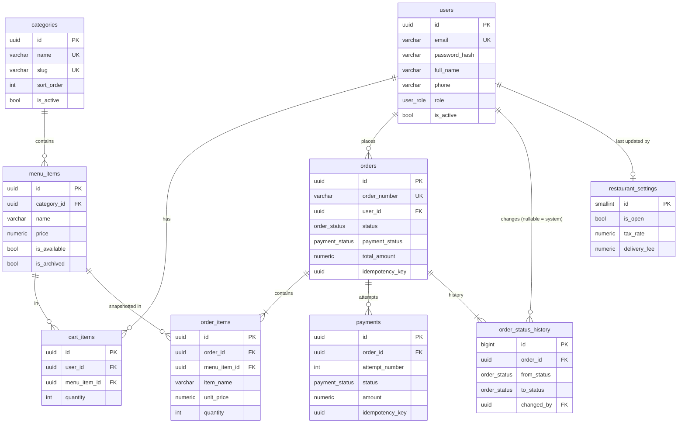

# 04 — Database Schema

PostgreSQL 16. Every table has `created_at timestamptz NOT NULL DEFAULT now()`. Mutable tables also have `updated_at`. Primary keys are UUIDs (`gen_random_uuid()`), except `order_status_history` (bigint identity) and `restaurant_settings` (fixed `1`). Constraint names follow a SQLAlchemy naming convention, so Alembic diffs stay stable.

## 1. Entity-relationship diagram



## 2. Enumerated types
```sql
CREATE TYPE user_role      AS ENUM ('CUSTOMER','STAFF','ADMIN');
CREATE TYPE order_status   AS ENUM ('PENDING_PAYMENT','PLACED','PREPARING','READY','DELIVERED','CANCELLED');
CREATE TYPE payment_status AS ENUM ('PENDING','SUCCESS','FAILED','REFUNDED');
CREATE TYPE payment_method AS ENUM ('CARD','UPI');
CREATE TYPE order_type     AS ENUM ('PICKUP','DELIVERY');
```

## 3. Tables

### users
| Column | Type | Constraints |
|---|---|---|
| id | uuid | PK |
| email | varchar(255) | NOT NULL. Unique index on `lower(email)` |
| password_hash | varchar(255) | NOT NULL |
| full_name | varchar(100) | NOT NULL |
| phone | varchar(20) | NULL |
| role | user_role | NOT NULL DEFAULT 'CUSTOMER' |
| is_active | boolean | NOT NULL DEFAULT true |
| created_at / updated_at | timestamptz | |

### restaurant_settings (single row)
| Column | Type | Constraints |
|---|---|---|
| id | smallint | PK, `CHECK (id = 1)` |
| name, tagline | varchar(120), varchar(200) | name NOT NULL |
| description | text | |
| address, phone, email | varchar | |
| hero_image_url | varchar(500) | |
| is_open | boolean | NOT NULL DEFAULT false |
| currency | char(3) | NOT NULL DEFAULT 'INR' |
| tax_rate | numeric(5,4) | NOT NULL, `CHECK (tax_rate BETWEEN 0 AND 0.30)` |
| delivery_fee | numeric(10,2) | NOT NULL, `CHECK (delivery_fee >= 0)` |
| pending_payment_ttl_minutes | int | NOT NULL DEFAULT 15, `CHECK (> 0)` |
| opening_hours | jsonb | NULL (informational, Could) |
| updated_by | uuid | FK → users.id ON DELETE SET NULL |
| updated_at | timestamptz | |

### categories
| Column | Type | Constraints |
|---|---|---|
| id | uuid | PK |
| name | varchar(60) | NOT NULL. Unique index on `lower(name)` |
| slug | varchar(80) | NOT NULL UNIQUE |
| description | varchar(300) | |
| sort_order | int | NOT NULL DEFAULT 0 |
| is_active | boolean | NOT NULL DEFAULT true |

Index: `(is_active, sort_order)`.

### menu_items
| Column | Type | Constraints |
|---|---|---|
| id | uuid | PK |
| category_id | uuid | NOT NULL, FK → categories.id **ON DELETE RESTRICT** |
| name | varchar(100) | NOT NULL |
| description | varchar(500) | |
| price | numeric(10,2) | NOT NULL, `CHECK (price > 0 AND price <= 100000)` |
| image_url | varchar(500) | |
| is_vegetarian | boolean | NOT NULL DEFAULT false |
| spice_level | smallint | NOT NULL DEFAULT 0, `CHECK (spice_level BETWEEN 0 AND 3)` |
| prep_time_minutes | smallint | NOT NULL DEFAULT 15, `CHECK (BETWEEN 1 AND 180)` |
| is_available | boolean | NOT NULL DEFAULT true |
| is_archived | boolean | NOT NULL DEFAULT false |

Indexes: `category_id`; partial index `(category_id, price) WHERE is_archived = false`; unique `(category_id, lower(name)) WHERE is_archived = false`. Optional: `pg_trgm` GIN index on `name` for search, if needed.

### cart_items
| Column | Type | Constraints |
|---|---|---|
| id | uuid | PK |
| user_id | uuid | NOT NULL, FK → users.id ON DELETE CASCADE |
| menu_item_id | uuid | NOT NULL, FK → menu_items.id ON DELETE CASCADE |
| quantity | int | NOT NULL, `CHECK (quantity BETWEEN 1 AND 50)` |

**`UNIQUE (user_id, menu_item_id)`** enforces rule 4 at the DB level. "Add" uses `INSERT … ON CONFLICT (user_id, menu_item_id) DO UPDATE SET quantity = cart_items.quantity + EXCLUDED.quantity`, guarded by the CHECK, so a merged total above 50 fails cleanly.

### orders
| Column | Type | Constraints |
|---|---|---|
| id | uuid | PK |
| order_number | varchar(24) | NOT NULL UNIQUE (`ORD-YYYYMMDD-` + `nextval('order_number_seq')`, zero-padded) |
| user_id | uuid | NOT NULL, FK → users.id ON DELETE RESTRICT |
| status | order_status | NOT NULL DEFAULT 'PENDING_PAYMENT' |
| payment_status | payment_status | NOT NULL DEFAULT 'PENDING' (summary of the latest attempt) |
| order_type | order_type | NOT NULL |
| delivery_address | varchar(300) | `CHECK (order_type = 'PICKUP' OR delivery_address IS NOT NULL)` |
| customer_notes | varchar(300) | |
| currency | char(3) | NOT NULL |
| subtotal | numeric(10,2) | NOT NULL, `CHECK (>= 0)` |
| tax_amount | numeric(10,2) | NOT NULL, `CHECK (>= 0)` |
| delivery_fee | numeric(10,2) | NOT NULL, `CHECK (>= 0)` |
| total_amount | numeric(10,2) | NOT NULL, `CHECK (total_amount = subtotal + tax_amount + delivery_fee)` |
| idempotency_key | uuid | NOT NULL |
| request_hash | char(64) | NOT NULL (SHA-256 of the normalised checkout body, to detect key reuse) |
| payment_expires_at | timestamptz | NOT NULL |
| placed_at | timestamptz | NULL. `CHECK (status IN ('PENDING_PAYMENT','CANCELLED') OR placed_at IS NOT NULL)` |
| cancelled_reason | varchar(300) | |

Constraints and indexes:
- **`UNIQUE (user_id, idempotency_key)`** — rule 8.
- `CHECK (status = 'PENDING_PAYMENT' OR status = 'CANCELLED' OR payment_status = 'SUCCESS')` — **rule 12 enforced in the DB**: an order cannot be PLACED or later without a successful payment.
- `INDEX (user_id, created_at DESC)` for customer history.
- `INDEX (status, created_at)` for the staff queue.
- `INDEX (placed_at)` for dashboard date ranges.

### order_items
| Column | Type | Constraints |
|---|---|---|
| id | uuid | PK |
| order_id | uuid | NOT NULL, FK → orders.id ON DELETE CASCADE |
| menu_item_id | uuid | NOT NULL, FK → menu_items.id **ON DELETE RESTRICT** |
| item_name | varchar(100) | NOT NULL (snapshot) |
| unit_price | numeric(10,2) | NOT NULL, `CHECK (> 0)` (snapshot) |
| quantity | int | NOT NULL, `CHECK (BETWEEN 1 AND 50)` |
| line_total | numeric(10,2) | NOT NULL, `CHECK (line_total = unit_price * quantity)` |

`UNIQUE (order_id, menu_item_id)`, `INDEX (menu_item_id)` (used by the "has this item ever been ordered?" check and top-items stats).

### payments
| Column | Type | Constraints |
|---|---|---|
| id | uuid | PK |
| order_id | uuid | NOT NULL, FK → orders.id ON DELETE RESTRICT |
| attempt_number | int | NOT NULL, `CHECK (> 0)` |
| method | payment_method | NOT NULL |
| status | payment_status | NOT NULL DEFAULT 'PENDING' |
| amount | numeric(10,2) | NOT NULL, `CHECK (> 0)` (copied from orders.total_amount) |
| currency | char(3) | NOT NULL |
| card_last4 | char(4) | NULL |
| provider_reference | varchar(64) | simulated transaction ID, e.g. `SIM-…` |
| failure_reason | varchar(200) | |
| idempotency_key | uuid | NOT NULL |
| completed_at, refunded_at | timestamptz | |

Constraints and indexes:
- `UNIQUE (order_id, attempt_number)`.
- `UNIQUE (order_id, idempotency_key)` — a repeated payment request returns the same attempt.
- **Partial unique index `ON payments (order_id) WHERE status IN ('SUCCESS','REFUNDED')`** — at most one successful payment per order, ever.
- `INDEX (order_id, created_at)`.

### order_status_history
| Column | Type | Constraints |
|---|---|---|
| id | bigint identity | PK |
| order_id | uuid | NOT NULL, FK → orders.id ON DELETE CASCADE |
| from_status | order_status | NULL (null for creation) |
| to_status | order_status | NOT NULL |
| changed_by | uuid | NULL, FK → users.id ON DELETE SET NULL (null = system) |
| actor_role | varchar(10) | NOT NULL (`CUSTOMER`/`STAFF`/`ADMIN`/`SYSTEM`) |
| note | varchar(300) | |
| created_at | timestamptz | |

`INDEX (order_id, created_at)`. Rows are append-only: the application never updates or deletes them.

## 4. Transaction boundaries

| Use case | Transaction contents | Locks |
|---|---|---|
| Add to cart | Validate item → upsert cart line | none (the upsert is atomic) |
| Checkout | Look up an existing order by (user, key) → lock user row → assert open → load cart + items → validate → price → insert order, order_items, history → delete cart_items | `SELECT … FROM users WHERE id = :me FOR UPDATE` |
| Payment attempt | Lock order → look up an existing attempt by key → assert payable/not expired/open/items available → insert PENDING payment → call simulated gateway → update payment + order + history | `SELECT … FROM orders WHERE id = :id FOR UPDATE` |
| Status change | Lock order → state machine check → update → history | order row `FOR UPDATE` |
| Admin cancel/refund | Lock order → transition to CANCELLED → payment SUCCESS→REFUNDED → order.payment_status = REFUNDED → history | order row `FOR UPDATE` |

## 5. Seed data
1 admin, 1 staff, 1 demo customer (credentials documented in the README for the demo only). Restaurant settings (open). 5 categories (Starters, Mains, Breads & Rice, Desserts, Beverages). About 20 items with images, including 2 marked unavailable so the rules can be demonstrated. A few historical orders in different statuses, so the dashboard has data.
