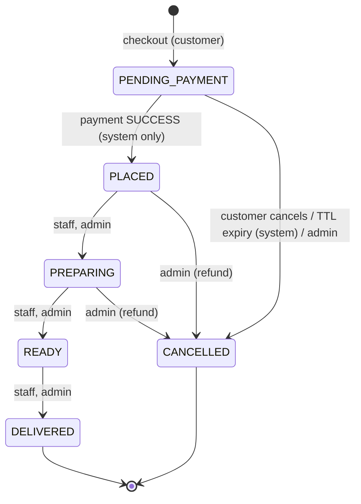

# 06 — Business Logic and Validation Rules

## 1. Order state machine



Implemented as a single data table in `order_state_machine.py`:

| From | To | Allowed actors | Side effects |
|---|---|---|---|
| — | PENDING_PAYMENT | CUSTOMER (checkout) | `payment_expires_at = now + ttl` |
| PENDING_PAYMENT | PLACED | SYSTEM (inside the payment success transaction) | `placed_at = now`. Requires `payment_status = SUCCESS` |
| PENDING_PAYMENT | CANCELLED | CUSTOMER (owner), ADMIN, SYSTEM (expiry) | optional restore to cart |
| PLACED | PREPARING | STAFF, ADMIN | |
| PLACED | CANCELLED | ADMIN | payment → REFUNDED. Reason required |
| PREPARING | READY | STAFF, ADMIN | |
| PREPARING | CANCELLED | ADMIN | payment → REFUNDED. Reason required |
| READY | DELIVERED | STAFF, ADMIN | |
| DELIVERED / CANCELLED | anything | nobody | terminal |

`assert_transition(current, target, actor_role)` raises `InvalidStatusTransition` (409) if the transition is not listed, or `Forbidden` (403) if it is listed but not for this role. **No API endpoint can set `PLACED` directly.** Only `payment_service` can, by calling the machine with `actor=SYSTEM`. The DB CHECK constraint backs this up.

Payment status (per attempt): `PENDING → SUCCESS | FAILED`, `SUCCESS → REFUNDED`. `orders.payment_status` mirrors the latest meaningful attempt (PENDING before any attempt, FAILED after a failed attempt, SUCCESS, REFUNDED).

## 2. Checkout algorithm (idempotent)

```
POST /orders  (Idempotency-Key: K, body B)
1. Validate header K (UUID) and body B (Pydantic, extra="forbid").
2. h = sha256(canonical_json(B))
3. existing = SELECT order WHERE user_id=me AND idempotency_key=K
   if existing: return 200 existing if existing.request_hash == h, else 409 IDEMPOTENCY_KEY_REUSED
4. BEGIN
   SELECT users WHERE id=me FOR UPDATE           -- serialise this user's checkouts
   re-run step 3 inside the lock                  -- closes the race window
   settings = load; if not settings.is_open → 409 RESTAURANT_CLOSED
   lines = cart_items JOIN menu_items JOIN categories WHERE user_id=me
   if no lines → 400 CART_EMPTY
   bad = [l for l in lines if not (item.is_available and not item.is_archived and category.is_active)]
   if bad → 409 ITEM_UNAVAILABLE {menu_item_ids}
   totals = pricing.compute(lines (DB prices), settings, order_type)
   order = INSERT orders(... order_number = next_order_number(), status=PENDING_PAYMENT,
                         payment_status=PENDING, idempotency_key=K, request_hash=h, totals...)
   INSERT order_items (snapshots: name, unit_price, quantity, line_total)
   INSERT order_status_history (null → PENDING_PAYMENT, actor=CUSTOMER)
   DELETE cart_items WHERE user_id=me
   COMMIT → 201 order
   on UniqueViolation(user_id, idempotency_key) → rollback, go to step 3 (return the winner)
```

## 3. Payment algorithm (idempotent and retry-safe)

```
POST /orders/{id}/payments  (Idempotency-Key: P, body)
1. Validate body (card Luhn/expiry format, or UPI format). Validation errors → 422, and no attempt is recorded.
2. BEGIN
   order = SELECT orders WHERE id=:id AND user_id=me FOR UPDATE   → 404 if missing
   prior = SELECT payments WHERE order_id=:id AND idempotency_key=P → if found: return 200 prior result
   if order.payment_status == SUCCESS or a SUCCESS payment exists → 409 ORDER_ALREADY_PAID
   if order.status != PENDING_PAYMENT → 409 ORDER_NOT_PAYABLE
   if now > order.payment_expires_at → set CANCELLED (system) + history, COMMIT, → 409 ORDER_EXPIRED
   if restaurant closed → 409 RESTAURANT_CLOSED
   if any order item now unavailable → 409 ITEM_UNAVAILABLE (customer may cancel + restore to cart)
   payment = INSERT payments(attempt_number = max+1, amount = order.total_amount, status=PENDING, key=P, last4)
   result = SimulatedGateway.charge(amount, method, details, simulate)   -- pure, deterministic
   if result.success:
       payment.status=SUCCESS, provider_reference, completed_at
       order.payment_status=SUCCESS
       state_machine.transition(order, PLACED, actor=SYSTEM)  → placed_at, history row
   else:
       payment.status=FAILED, failure_reason
       order.payment_status=FAILED                          -- order.status stays PENDING_PAYMENT
   COMMIT → 201 {payment, order}
```
The row lock means two concurrent payment requests for one order run one after the other. The second one sees `ORDER_ALREADY_PAID`. The partial unique index is the final safety net.

## 4. Pricing rules (`pricing.py`, pure functions)
- `line_total = unit_price × quantity`. The unit price always comes from the database.
- `subtotal = Σ line_total`
- `tax_amount = round_half_up(subtotal × tax_rate, 2)`
- `delivery_fee = settings.delivery_fee if order_type == DELIVERY else 0`
- `total = subtotal + tax_amount + delivery_fee`
- All values are `Decimal` and quantised to `0.01`. A float is never constructed.
- Order amounts are frozen at checkout. Later menu or settings changes never alter an existing order.

## 5. Validation rules

| Field | Rule |
|---|---|
| email | Valid format, ≤ 255 characters, stored lower-cased, unique |
| password | 8–128 characters, at least 1 letter and 1 digit |
| full_name | 2–100 characters, trimmed |
| phone | Optional, `^\+?[0-9]{10,15}$` |
| quantity | **Strict integer**, 1–50 per line (the merged total is also ≤ 50). Maximum 30 lines per cart |
| menu price | > 0, ≤ 100000, at most 2 decimal places |
| item name | 2–100 characters, unique within its category among non-archived items |
| description | ≤ 500 characters |
| spice_level | 0–3; prep_time 1–180 |
| category name | 2–60 characters, unique (case-insensitive) |
| delivery_address | Required (10–300 characters) when order_type = DELIVERY. Must be null/ignored for PICKUP |
| customer_notes | ≤ 300 characters |
| card number | 12–19 digits, Luhn-valid. Expiry `MM/YY` not in the past. CVV 3–4 digits (never stored) |
| UPI ID | `^[a-zA-Z0-9.\-_]{2,256}@[a-zA-Z]{2,64}$` |
| image upload | JPEG/PNG/WebP (checked with Pillow, not by file extension), ≤ 2 MB |
| tax_rate | 0–0.30. delivery_fee ≥ 0. ttl 5–120 minutes |
| Idempotency-Key | UUID |

## 6. Mandatory rule traceability

| # | Rule | Enforced in | DB backstop | Test |
|---|---|---|---|---|
| 1 | Unavailable items cannot be added to the cart | `cart_service.add_item` | — | `test_cart.py::test_add_unavailable_item_rejected` |
| 2 | Checkout revalidates availability | `order_service.checkout` (+ again at payment) | — | `test_checkout.py::test_item_became_unavailable_blocks_checkout` |
| 3 | Quantities are positive integers | Pydantic strict int 1–50 | `CHECK quantity BETWEEN 1 AND 50` | `test_cart.py::test_invalid_quantities[0,-1,1.5,"2",51]` |
| 4 | Duplicate items merge quantities | upsert `ON CONFLICT` | `UNIQUE(user_id, menu_item_id)` | `test_cart.py::test_add_same_item_merges_quantity` |
| 5 | Backend calculates all totals | `pricing.compute` | `CHECK total = subtotal+tax+fee`, `CHECK line_total = …` | `test_pricing.py`, `test_checkout.py::test_totals_computed_server_side` |
| 6 | Frontend prices never trusted | Schemas exclude prices (`extra="forbid"`) | — | `test_checkout.py::test_client_prices_rejected` |
| 7 | Unique order IDs | UUID PK + sequence-based order_number | `UNIQUE(order_number)` | `test_checkout.py::test_order_numbers_unique` |
| 8 | Idempotent order creation | Idempotency-Key lookup + lock | `UNIQUE(user_id, idempotency_key)` | `test_checkout.py::test_duplicate_submission_returns_same_order`, `::test_concurrent_duplicate_submission` |
| 9 | Simulated success/failure | `SimulatedGateway` | — | `test_payments.py::test_success`, `::test_failure` |
| 10 | Failed payments don't place the order | `payment_service` | CHECK (status vs payment_status) | `test_payments.py::test_failed_payment_keeps_pending` |
| 11 | Retry without duplicate orders | Payment on an existing order | `UNIQUE(order_id, attempt_number)` | `test_payments.py::test_retry_after_failure_single_order` |
| 12 | Only paid orders become PLACED | State machine (SYSTEM only) | CHECK constraint | `test_admin_orders.py::test_cannot_set_placed_manually` |
| 13 | Valid transitions only | `order_state_machine` | — | `test_state_machine.py` (parametrised over every pair), `test_admin_orders.py::test_invalid_transition_409` |
| 14 | Status history kept | Every transition writes history | append-only table | `test_admin_orders.py::test_history_recorded` |
| 15 | Role-based authorization | `require_roles` dependencies | — | `test_authorization.py` (parametrised over endpoints × roles) |
| 16 | No ordering while closed | `restaurant_service.assert_open` at checkout and payment | — | `test_checkout.py::test_closed_restaurant_blocks_checkout` |
| — | One successful payment per order | `payment_service` lock + check | partial unique index | `test_payments.py::test_pay_twice_conflict` |
